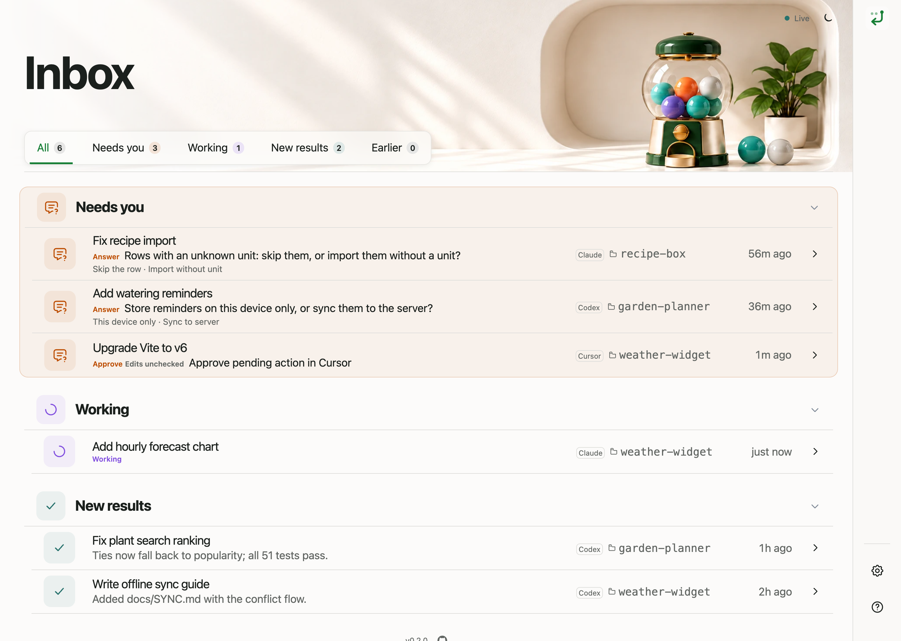
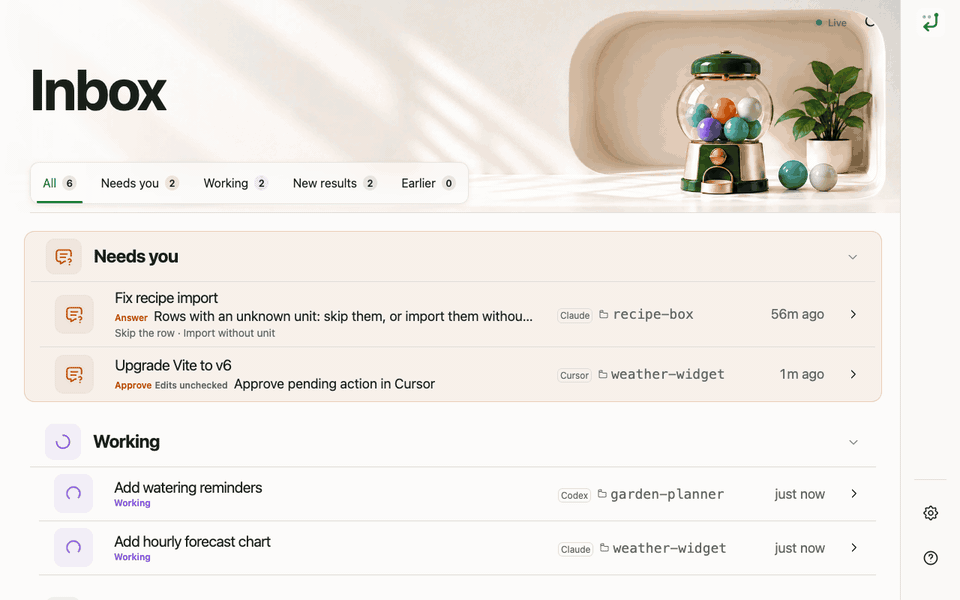
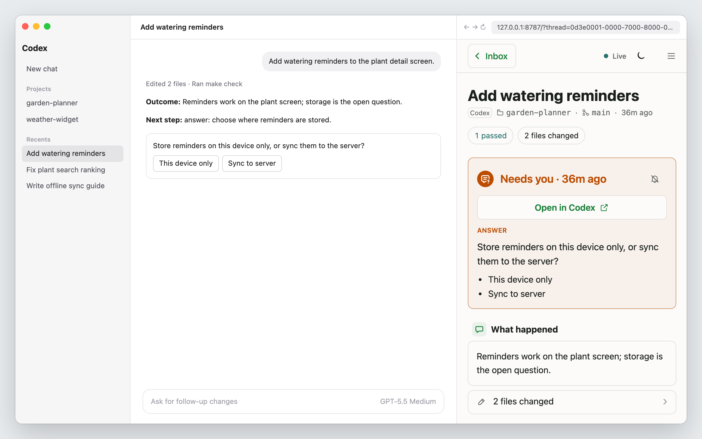

<div align="center">

# Your Turn

### Your agents are fast. You're the queue.


[Quickstart](#quickstart) · [Keep it next to your chat](#keep-it-next-to-your-chat) ·
[Privacy](#privacy-and-design) · [Docs](#docs)

</div>

When Codex, Claude Code, and Cursor run side by side, the slow part is your attention. The chat blocked on you sits in a window you are not looking at, and every answer is a long log.

**Your Turn** is not another orchestrator, IDE wrapper, or cloud dashboard. It is a read-only, zero-config local inbox that reads the logs your agents already write and answers three questions at a glance:

* ⏳ **Who is waiting on you?**  
  Questions, pending approvals, and unreviewed results, ordered strictly by how long they have waited.

* ✅ **Can you trust the result without reading the log?**  
  `Check failed` and `Edits unchecked` badges tied deterministically to the latest code edit.

* ➡️ **What is the exact next step, and which decisions were made?**  
  One line each, with a single click to resume or open the chat in its native app.

<div align="center">



<sub>Made-up demo chats from <code>make screenshots</code>, not real session data.</sub>

</div>

<details>
<summary>Watch the 12s triage flow (GIF)</summary>



</details>

## Keep It Next to Your Chat



Your Turn runs in any browser, but it works best right beside the agent you are driving. Open
`http://localhost:8787` in the Codex in-app browser, or in a Simple Browser panel in Cursor or
VS Code, and you never switch windows to see who needs you.

## Quickstart

You need Python 3.11+, [`uv`](https://docs.astral.sh/uv/), and at least one of Codex, Claude Code,
or Cursor.

**1. Install.** Run this once in a terminal:

```sh
uvx --from git+https://github.com/martin-gomola/your-turn your-turn install
```

It adds a skill or rule to each agent it finds, so replies end with `Outcome:` and `Next step:`.
Then it starts the inbox. Your projects stay untouched.

<details>
<summary>What it changes per agent</summary>

It writes only to the agents' own folders: `~/.codex`, `~/.claude`, `~/.cursor`, and `~/.agents`.

- **Codex**: installs the `your-turn` plugin, or, without the Codex CLI, saves the skill in
  `~/.agents/skills`, which the Codex app reads too.
- **Claude Code**: saves the skill and adds a block to `~/.claude/CLAUDE.md`.
- **Cursor**: saves the skill, and the rule that applies it in every chat as a local plugin.

</details>
<br>

**2. Restart the apps it names** at the end of its output, so they load the handoff.

**3. Open [http://localhost:8787](http://localhost:8787).** Your existing chats are already there.

**Next time**, start the inbox with:

```sh
uvx --from git+https://github.com/martin-gomola/your-turn your-turn serve
```

<details>
<summary>Check, remove, or troubleshoot the install</summary>

To check the install without changing anything, or to remove it:

```sh
uvx --from git+https://github.com/martin-gomola/your-turn your-turn doctor
uvx --from git+https://github.com/martin-gomola/your-turn your-turn uninstall
```

`serve` also works without `install`; recaps are then guessed. If your Cursor admin turned local
plugins off, add the rule by hand as described in
[docs/configuration.md](./docs/configuration.md#cursor-user-rule).

</details>

### Why install the handoff skill?

Agents often close with a polite offer, and Your Turn reads a closing question as a request, so the
chat lands in **Needs you** although nothing waits on you. The handoff skill replaces that ending
with two lines Your Turn can read without guessing.

Without the skill, the closing question raises a false **Needs you**:

```text
I refactored the token refresh logic and ran pytest (all 12 tests passed).
Would you like me to update the documentation or commit the changes?
```

With the skill, the chat goes to **New results** with its outcome on one line:

```text
I refactored the token refresh logic and ran pytest (all 12 tests passed).
You can update the docs or commit when ready.

**Outcome:** Token refresh is refactored and all 12 tests pass.
**Next step:** none
```

When the agent does need you, `Next step` says how, for example `review: the retry limit in
auth.py` or `approve: git push`. The full list is in
[docs/configuration.md](./docs/configuration.md#your-turn-handoff).

## Privacy and Design

- 🔒 **Local only.** The server binds `127.0.0.1` (the address behind `localhost`); nothing leaves your machine.
- 👀 **Strictly read-only.** It never writes to session files or Cursor's SQLite database, and never
  starts, answers, or approves anything. Its only file is `~/.your-turn/state.json`, which keeps
  seen results and dismissed reminders in sync across browsers, with a browser-local backup for recovery.
- ⚙️ **Zero config.** No account and no setup file; it finds the chats you already have and leaves
  out sub-agents, headless runs, and abandoned chats.

Every feature has to shorten one of the three questions above; anything else stays out.

## Docs

| Guide | What is in it |
| --- | --- |
| [docs/harnesses.md](./docs/harnesses.md) | Data sources per OS, Codex vs Claude Code vs Cursor, Needs you rules, check tags, what stays out, limits |
| [docs/configuration.md](./docs/configuration.md) | CLI flags, environment, `install` / `uninstall` per app, the handoff contract, development |
| [DESIGN.md](./DESIGN.md) | Design contract and the UI's references |
| [docs/agents-snippet.md](./docs/agents-snippet.md) | The handoff format to paste without installing anything |

## Run from a clone

```sh
git clone https://github.com/martin-gomola/your-turn.git
cd your-turn
make install   # set up the handoff from this checkout, start the server
```

Then open [http://localhost:8787](http://localhost:8787). Later, from the same folder:

```sh
make up        # start the server in the background
make down      # stop it
make doctor    # check the installed handoff without changing it
make test      # run the test suite
```

All `make` targets and API routes are in [docs/configuration.md](./docs/configuration.md#development).

## License

[MIT](./LICENSE). Third-party icons and artwork notes are in [THIRD_PARTY_NOTICES.md](./THIRD_PARTY_NOTICES.md).
