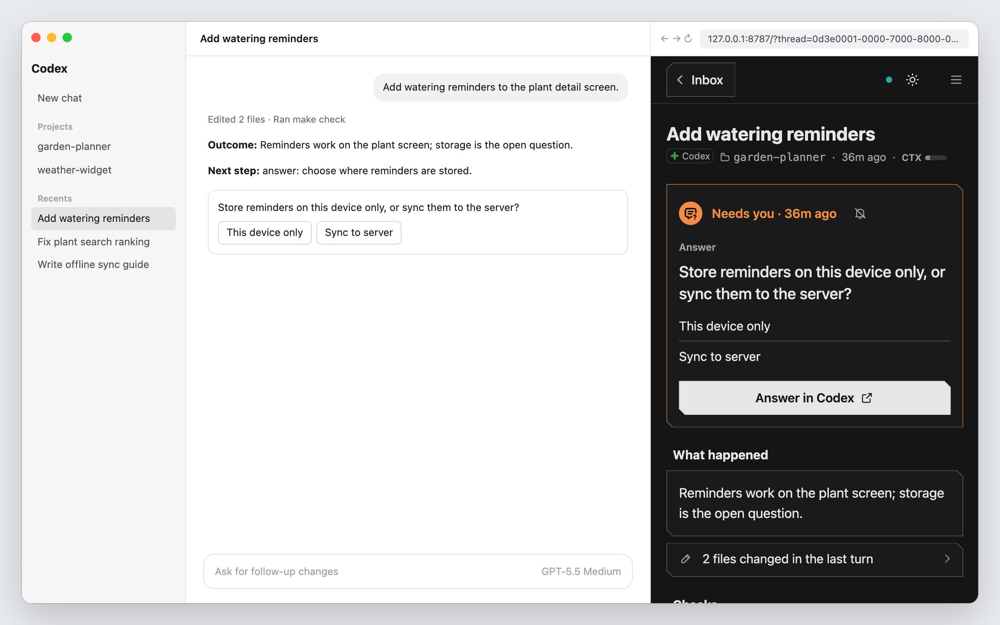

<div align="center">

# Your Turn

<p align="center"><strong>Your agents are fast. You're the queue.</strong></p>


[Quick start](#quick-start) · [Handoff skill](#handoff-skill) · [Your inbox](#your-inbox) · [Privacy](#privacy) · [Docs](#docs)

</div>

**Your Turn** shows your coding-agent chats in one local inbox, with a handoff skill for clear results and next steps. You can also use just the skill directly in chat, with no server.

<div align="center">


<sub>The optional inbox, with made-up demo chats from <code>make screenshots</code>. The skill also works on its own.</sub>

</div>

## Quick start

Choose [Full setup](#full-setup) for the inbox and handoff skill, or install [just the skill](#skill-only-no-server) from **your-turn-loop** for handoffs in your existing chats.

> [!TIP]
> **[Open the install page](https://martin-gomola.github.io/your-turn/)** to pick your agents and options and copy the matching commands.

---

### Full setup

You need [`uv`](https://docs.astral.sh/uv/) and Codex, Claude Code, or Cursor. `uv` downloads Python 3.11 or newer if you do not have it. Without `uv`, install it first with `brew install uv` or [uv's installer](https://docs.astral.sh/uv/getting-started/installation/).

```bash
uvx your-turn@latest install
```

`install` adds the Your Turn handoff instructions to the agent apps it finds, then starts the inbox. Restart those agent apps, then open [http://localhost:8787](http://localhost:8787).

> [!NOTE]
> To preview which files `install` would write without changing anything, run `uvx your-turn@latest doctor`.

To start the inbox on later visits, or if you already have the skill, run:

```bash
uvx your-turn@latest serve
```

Keep the terminal open while using the inbox. Stop it with Ctrl+C.

<details>
<summary>Start the inbox with Codex (optional, macOS/Linux)</summary>

Use a persistent installation, then opt in to a user-level Codex hook:

```bash
uv tool install your-turn
your-turn autostart enable
```

Review the hook in `/hooks` in the Codex CLI or **Settings → Hooks** in the desktop app. Enabling autostart does not grant hook trust or verify that Codex loaded it. On `SessionStart`, the hook starts or reuses one background inbox without opening a browser.

The handoff stays instruction-only. Disable the hook with `your-turn autostart disable`; the shared inbox keeps running until you stop it with `your-turn stop`. See [autostart setup and diagnostics](./docs/configuration.md#optional-codex-autostart), including what to do if the installed Python environment changes.

</details>

<details>
<summary>Use a phone or uninstall</summary>

The server binds to loopback only (`127.0.0.1`). To remove the handoff, run `uvx your-turn@latest uninstall`.

To open the inbox on your phone, run `uvx your-turn@latest serve --phone` (in a clone: `make phone`) and scan the QR code it prints. The phone needs to be on the same Wi-Fi or Tailscale network, and the link carries a token; delete `~/.your-turn/phone-token` to lock out paired phones.

</details>

<details>
<summary>Check where a release comes from, or pin one</summary>

`uvx your-turn@latest` runs the newest [PyPI release](https://pypi.org/project/your-turn/), which GitHub Actions builds from a Git tag and PyPI shows with its attestation. Without `@latest`, `uv` keeps reusing the release it downloaded first. To pin a version, use `uvx your-turn@0.7.0`, or install straight from its tag with `uvx --from git+https://github.com/martin-gomola/your-turn@v0.7.0 your-turn`.

</details>

<details>
<summary>Run with Nix instead</summary>

The repository is a flake, with dependencies pinned in `flake.lock`. This starts the inbox without changing any agent app:

```bash
nix run github:martin-gomola/your-turn
```

Only `install` and `uninstall` change agent app folders. To see what `install` would touch, run `nix run github:martin-gomola/your-turn -- doctor` first. To skip it, add the handoff by hand from [docs/agents-snippet.md](./docs/agents-snippet.md), or print the Cursor rule with `nix run github:martin-gomola/your-turn -- cursor-rule`. `nix profile install github:martin-gomola/your-turn` puts `your-turn` on your `PATH`. To pin a release, use `github:martin-gomola/your-turn/v0.7.0`.

</details>

---

<a id="install-the-skill"></a>

### Skill only (no server)

Install **your-turn-handoff** with
[the your-turn-loop installer](https://martin-gomola.github.io/your-turn-loop/).
See [docs/handoff.md](./docs/handoff.md#install-only-the-skill) for requirements, first use, and adding the inbox later.

<a id="why-install-the-handoff"></a>

## Handoff skill

The handoff asks the agent to add to each answer an `Outcome` line and a `Next step` line that names what needs you, or `none`. See [docs/handoff.md](./docs/handoff.md) for an example.

## Your inbox

The inbox shows which Codex, Claude Code, and Cursor chats need you. It is not an orchestrator or IDE wrapper: execution, answers, and approvals stay in each agent's app.

<details>
<summary>See the inbox beside a chat</summary>



</details>

<details>
<summary>Watch a chat move into Needs you</summary>


</details>

<details>
<summary>See the Deck on a second screen or tablet</summary>


</details>
<br>

The inbox runs on `localhost:8787` and reads the JSONL logs your agents already write and the local Cursor chat database. For each chat it shows:

- Questions, pending approvals, and unreviewed results, ordered by how long they have waited.
- `Check failed` and `Edits unchecked` badges tied to the latest code edit.
- The next step in one line, with one click to open or resume the chat in its app.

From a phone or tablet, "Open in Codex" and "Open in Cursor" ask your Mac to open that chat's link.

## Privacy

- **Local only.** The server binds to `127.0.0.1`. It does not send session data anywhere.
- **Read-only session access.** Your Turn reads agent logs and Cursor's local chat database. It never edits them, starts or answers chats, or approves actions.
- **Small local state file.** `~/.your-turn/state.json` stores seen results and dismissed reminders so they stay in sync across browsers. The browser keeps a local backup.
- **No account or setup file.** Your Turn finds existing chats and leaves out sub-agents, headless runs, and abandoned chats.

## Docs

| Guide | What it covers |
| --- | --- |
| [docs/harnesses.md](./docs/harnesses.md) | Data sources by OS, supported apps, inbox states, checks, and limits |
| [docs/handoff.md](./docs/handoff.md) | What the handoff looks like, and installing only the skill |
| [docs/configuration.md](./docs/configuration.md) | CLI commands and flags, app setup, handoff format, and development |
| [DESIGN.md](./DESIGN.md) | UI design contract and references |
| [docs/agents-snippet.md](./docs/agents-snippet.md) | Handoff format to add to agent instructions by hand |
| [docs/handoff-source.md](./docs/handoff-source.md) | Canonical handoff source, pinned snapshot and package checks |

## Run from a clone

```bash
git clone https://github.com/martin-gomola/your-turn.git
cd your-turn
make install
```

`make install` sets up the handoff from this checkout and starts the inbox. Open [http://localhost:8787](http://localhost:8787). Later, from the same folder:

```bash
make up        # start the inbox in the background
make down      # stop it
make phone     # restart it reachable from your phone: scan the printed QR code
make doctor    # check the handoff without changing it
make test      # run the test suite
make demo      # made-up chats in every Deck state at http://127.0.0.1:8790/deck, for design QA
make site      # the install page at http://127.0.0.1:8791
```

See [docs/configuration.md](./docs/configuration.md#development) for all `make` targets and API routes.

## License

[MIT](./LICENSE). Third-party icons and artwork are listed in [THIRD_PARTY_NOTICES.md](./THIRD_PARTY_NOTICES.md).
