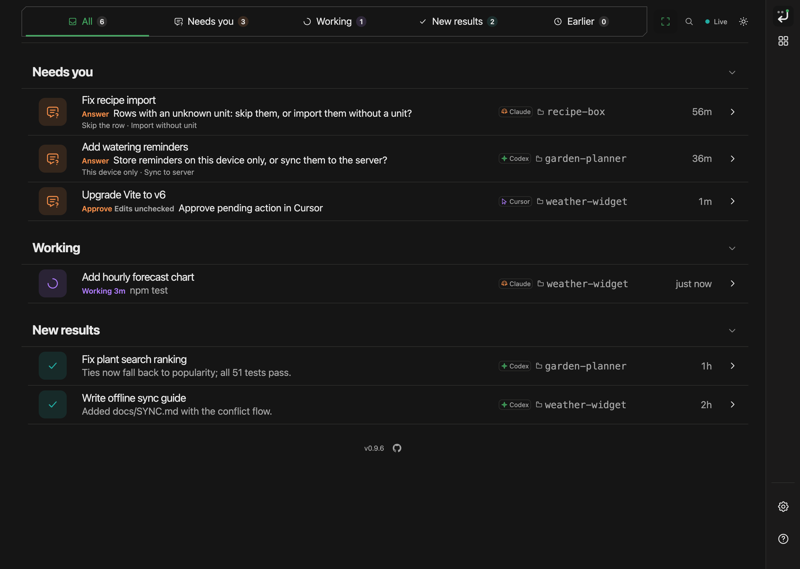
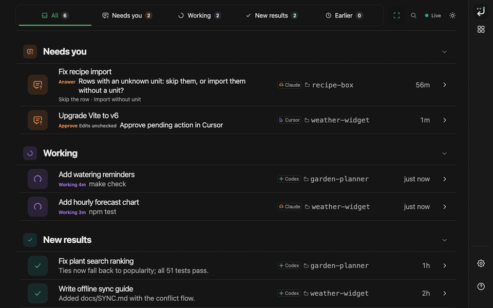
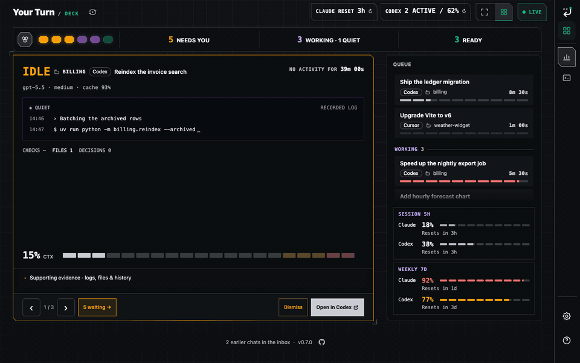

<div align="center">

# Your Turn

<p align="center"><strong>Your agents are fast. You're the queue.</strong></p>


[Quick start](#quick-start) · [Handoff skill](#handoff-skill) · [Why Your Turn](#why-your-turn) ·
[Your inbox](#your-inbox) · [Privacy](#privacy) · [Docs](#docs)

</div>

**Your Turn** shows your coding-agent chats in one local inbox, with a handoff skill for clear results and next steps. You can also use just the skill directly in chat, with no server.

<div align="center">



<sub>The optional inbox, with made-up demo chats from <code>make screenshots</code>. The skill also works on its own.</sub>

</div>

## Quick start

Choose [Full setup](#full-setup) for the inbox and handoff skill, or [Skill only](#skill-only-no-server) for handoffs in your existing chats.

### Full setup

You need [`uv`](https://docs.astral.sh/uv/) and Codex, Claude Code, or Cursor. `uv` downloads Python 3.11 or newer if you do not have it. Without `uv`, install it first with `brew install uv` or [uv's installer](https://docs.astral.sh/uv/getting-started/installation/).

To see which files `install` would write, run `uvx your-turn@latest doctor` first; it changes nothing. Then run:

```bash
uvx your-turn@latest install
```

Run in a terminal, `install` adds the Your Turn handoff instructions to the agent apps it finds, then starts the inbox. Restart those agent apps, then open [http://localhost:8787](http://localhost:8787).

To start the inbox on later visits, or if you already have the skill, run:

```bash
uvx your-turn@latest serve
```

Keep the terminal open while using the inbox. Stop it with Ctrl+C.

<details>
<summary>Start the inbox with Codex (optional, macOS/Linux)</summary>

Use a persistent installation, then opt in to a user-level Codex hook:

```bash
uv tool install your-turn
your-turn autostart enable
```

Review the hook in `/hooks` in the Codex CLI or **Settings → Hooks** in the desktop app. Enabling autostart does not grant hook trust or verify that Codex loaded it. On `SessionStart`, the hook starts or reuses one background inbox without opening a browser.

The default plugin stays instruction-only. Disable the hook with `your-turn autostart disable`; the shared inbox keeps running until you stop it with `your-turn stop`. See [autostart setup and diagnostics](./docs/configuration.md#optional-codex-autostart), including what to do if the installed Python environment changes.

</details>

<details>
<summary>Use a phone or uninstall</summary>

The server binds to loopback only (`127.0.0.1`). To remove the handoff, run `uvx your-turn@latest uninstall`.

To open the inbox on your phone, run `uvx your-turn@latest serve --phone` (in a clone: `make phone`) and scan the QR code it prints. The phone needs to be on the same Wi-Fi or Tailscale network, and the link carries a token; delete `~/.your-turn/phone-token` to lock out paired phones.

</details>

<details>
<summary>Check where a release comes from, or pin one</summary>

`uvx your-turn@latest` runs the newest [PyPI release](https://pypi.org/project/your-turn/), which GitHub Actions builds from a Git tag and PyPI shows with its attestation. Without `@latest`, `uv` keeps reusing the release it downloaded first. To pin a version, use `uvx your-turn@0.6.1`, or install straight from its tag with `uvx --from git+https://github.com/martin-gomola/your-turn@v0.6.1 your-turn`.

</details>

<details>
<summary>Run with Nix instead</summary>

The repository is a flake, with dependencies pinned in `flake.lock`. This starts the inbox without changing any agent app:

```bash
nix run github:martin-gomola/your-turn
```

Only `install` and `uninstall` change agent app folders. To see what `install` would touch, run `nix run github:martin-gomola/your-turn -- doctor` first. To skip it, add the handoff by hand from [docs/agents-snippet.md](./docs/agents-snippet.md), or print the Cursor rule with `nix run github:martin-gomola/your-turn -- cursor-rule`. `nix profile install github:martin-gomola/your-turn` puts `your-turn` on your `PATH`. To pin a release, use `github:martin-gomola/your-turn/v0.6.1`.

</details>

<a id="install-the-skill"></a>

### Skill only (no server)

These instruction-only paths need no running inbox, `uv` or Python.

#### Codex

Requires the Codex CLI. Install the instruction-only plugin, then restart Codex:

```bash
codex plugin marketplace add martin-gomola/your-turn
codex plugin add your-turn@your-turn
```

<details>
<summary>Update or remove the Codex plugin</summary>

Codex keeps the marketplace at the commit it fetched. To pick up a newer skill, run `codex plugin marketplace upgrade your-turn && codex plugin add your-turn@your-turn`, then restart Codex. To remove it, run `codex plugin remove your-turn@your-turn` and `codex plugin marketplace remove your-turn`.

</details>

#### Claude Code and Cursor

- **Claude Code:** append the [manual handoff block](./docs/agents-snippet.md) to `~/.claude/CLAUDE.md`.
- **Cursor:** open **Customize → Rules**, add a **User Rule**, and paste the [Cursor rule](./docs/configuration.md#cursor-user-rule).

Start a new chat to load the instructions. The [manual block](./docs/agents-snippet.md) also works in an instruction file your agent reads if you prefer to set up Codex by hand.

<a id="why-install-the-handoff"></a>

## Handoff skill

The handoff asks the agent to put its result and the action that needs you in predictable lines. Here, you asked the agent to compare import policies and wait for your choice before implementation.

Without the handoff:

```text
I recommend skipping invalid rows and logging them so valid rows can still import.
The alternative is stopping at the first invalid row. Which policy should I implement?
```

With the handoff:

```text
**Outcome:** Skipping and logging invalid rows is recommended so valid rows can still import.

**Next step:** decide: skip and log invalid rows, or stop at the first invalid row?
```

If your input is needed, `Next step` names the answer, decision, review, approval, or command. Otherwise, it says `none`. Longer chats keep a `Recap`, and consequential choices get a `Decision`. See the [full handoff format](./docs/configuration.md#handoff-contract).

## Why Your Turn

When Codex, Claude Code, and Cursor run side by side, the slow part is your attention. The chat blocked on you sits in a window you are not looking at, and every answer is a long log.

Your Turn keeps the result and next step in the chat, with an optional view across chats. It is not another orchestrator, IDE wrapper, or cloud dashboard. The inbox reads the logs agents already write and leaves execution, answers, and approvals in their own apps.

## Your inbox

Add the local inbox when you want to see which chats need you across Codex, Claude Code, and Cursor.

<details>
<summary>See the inbox beside a chat</summary>


</details>

<details>
<summary>Watch a chat move into Needs you</summary>



</details>

<details>
<summary>See the Deck on a second screen or tablet</summary>



</details>
<br>

The optional inbox is read-only and zero-config on `localhost:8787`. It reads the JSONL logs your agents already write and the local Cursor chat database. It answers three questions at a glance:

- ⏳ **Who is waiting on you?**<br>
  Questions, pending approvals, and unreviewed results, ordered by how long they have waited.<br>
- ✅ **Can you trust the result without reading the log?**<br>
  `Check failed` and `Edits unchecked` badges tied to the latest code edit.<br>
- ➡️ **What is the exact next step?**<br>
  One line per chat, with one click to open or resume it in its app.<br>

The inbox runs on your machine. It does not take over agent processes or send chat data to the cloud. It uses no cloud account or extra agent permissions. From a phone or tablet, "Open in Codex" and "Open in Cursor" ask your Mac to open that chat's own link, the same as clicking it there.

## Privacy

- **Local only.** The server binds to `127.0.0.1`. It does not send session data anywhere.
- **Read-only session access.** Your Turn reads agent logs and Cursor's local chat database. It never edits them, starts or answers chats, or approves actions.
- **Small local state file.** `~/.your-turn/state.json` stores seen results and dismissed reminders so they stay in sync across browsers. The browser keeps a local backup.
- **No account or setup file.** Your Turn finds existing chats and leaves out sub-agents, headless runs, and abandoned chats.

## Docs

| Guide | What it covers |
| --- | --- |
| [docs/harnesses.md](./docs/harnesses.md) | Data sources by OS, supported apps, inbox states, checks, and limits |
| [docs/configuration.md](./docs/configuration.md) | CLI commands and flags, app setup, handoff format, and development |
| [DESIGN.md](./DESIGN.md) | UI design contract and references |
| [docs/agents-snippet.md](./docs/agents-snippet.md) | Handoff format to add to agent instructions by hand |
| [docs/handoff-source.md](./docs/handoff-source.md) | Canonical handoff source, pinned snapshot and package checks |

## Run from a clone

```bash
git clone https://github.com/martin-gomola/your-turn.git
cd your-turn
make install
```

`make install` sets up the handoff from this checkout and starts the inbox. Open [http://localhost:8787](http://localhost:8787). Later, from the same folder:

```bash
make up        # start the inbox in the background
make down      # stop it
make phone     # restart it reachable from your phone: scan the printed QR code
make doctor    # check the handoff without changing it
make test      # run the test suite
make demo      # made-up chats in every Deck state at http://127.0.0.1:8790/deck, for design QA
```

See [docs/configuration.md](./docs/configuration.md#development) for all `make` targets and API routes.

## License

[MIT](./LICENSE). Third-party icons and artwork are listed in [THIRD_PARTY_NOTICES.md](./THIRD_PARTY_NOTICES.md).
